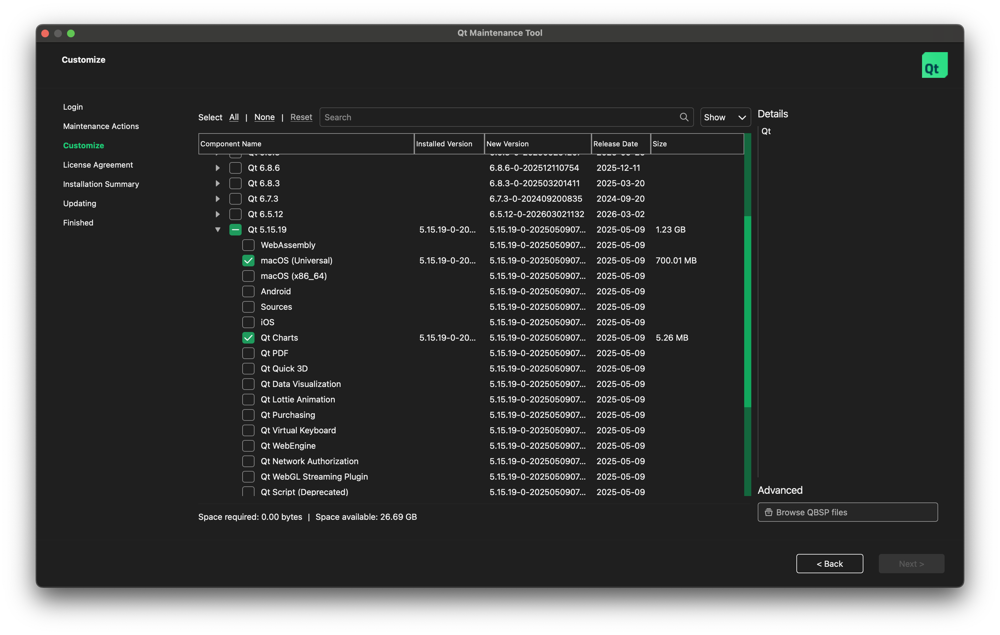

all the fritzing application build follows this [blog post](https://siytek.com/build-fritzing/)

## Dependencies

- cmake: which u can install using `brew install cmake` or if you dont have brew then `/bin/bash -c "$(curl -fsSL https://raw.githubusercontent.com/Homebrew/install/master/install.sh)"`
- libgit2
- boost
- fritzing-parts
- qt creator

## Dependencies Installation

### libgit2

```bash
cd libgit2 && mkdir build && cd build
cmake -DBUILD_SHARED_LIBS=OFF ..
cmake --build .
```

### boost

you dont have to compile boost i guess because it is a cpp library header-only

### fritzing-parts

```bash
git clone https://github.com/fritzing/fritzing-parts.git
```

### QT Creator

download it whatever way you prefer [here](https://doc.qt.io/qtcreator/creator-how-to-install.html)

you're gonna get a maintainance tool app for Qt (if cannot find, it's probably in ~/Qt/MaintainanceTool.app)

You should install qt version 5.15.19
select the following


